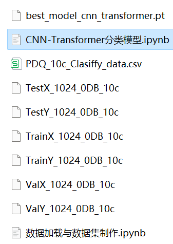

# CNN-Transformer Power Quality Disturbance Signal Classification: One-Dimensional Signal Classification

Includes a complete dataset of power quality disturbance signals, as well as a dataset of ten-class disturbance signals, categorized data, and label sets that have been generated and prepared.
Includes code for data preprocessing and the CNN-Transformer classification model code.
Environment: Python 3.9
Python Power Quality Disturbance Signal Classification (Part 5): One-Dimensional Signal Classification Model Based on CNN-Transformer
Introduction
This article is based on the power quality disturbance signal simulated by Python, firstly preprocessed data to make and load the dataset, then implemented the CNN-Transformer model for the classification of disturbance signals through Pytorch.
The waveform diagram of some disturbed signal types is as follows:
\t  
1. Data set creation and loading
1.1 Import data
A disturbance signal model is constructed based on the IEEE Std1159-2019 power quality detection standards and related literature. Ten types of single signals and various composite disturbance signals are generated, including normal signals. Preprocessing for the 10-class classification of disturbance signals is conducted in reference to previous articles.
Step 1: Generate a single signal according to the formula model.
1.1 Single disturbance signal visualization:
Step 2: Import the data into categories.
import pandas as pd  
import numpy as np  
# Sample duration: 0.2s, sample step size: 1024, generate 500 samples per signal, noise level: 0dB
window_step = 1024  
samples = 500  
noise = 0  
split_rate = [0.7, 0.2, 0.1]  # training set, validation set, test set split ratios  
```
# Read processed CSV files
dataframe_10c = pd.read_csv('PDQ_10c_Clasiffy_data.csv' )  
dataframe_10c.shape  
1.2 Dataset creation
Step 1: Define the dataset creation function.
Step 2: Dataset Preparation and Classification Labels
2. CNN-Transformer Classification Model and Hyperparameter Selection
2.1 Define the CNN-Transformer classification model
\tNote: The input data dimension is [64, 1, 1024]. First, it is fed into a CNN network for 1D convolutional pooling. Then, the spatial features from the convolutional pooling are fed into a Transformer to enhance the signal features. Finally, it is fed into a fully connected layer and softmax for classification.
2.2 Set parameters and train the model
100 epochs, nearly 100% accuracy. The CNN-Transformer model performs well in classification with high accuracy and superior performance. By appropriately adjusting the model parameters, further improvements in classification accuracy can be achieved.
\tNote: Adjust parameters.
\tIt is appropriate to increase the number of CNN layers and the dimensionality of hidden layers, and fine-tune the learning rate.
Increase the number of Transformer encoder layers and dimensions, and increase more epochs (note to prevent overfitting)
\tThe shape of a one-dimensional signal stack can be changed (by setting the appropriate length and dimensions).
3 Model Evaluation
\t3.1 Accuracy, Precision, Recall, F1 Score
\t3.2 Category Confusion Matrix:
\n        \n  

## Images



<!-- PAYMENT_BLOCK -->

## Get this dataset

- Payment link (Stripe): [Buy now](https://buy.stripe.com/3cs8yP7sY87d0vu9AB)
- Payment QR code: 

<!-- /PAYMENT_BLOCK -->
